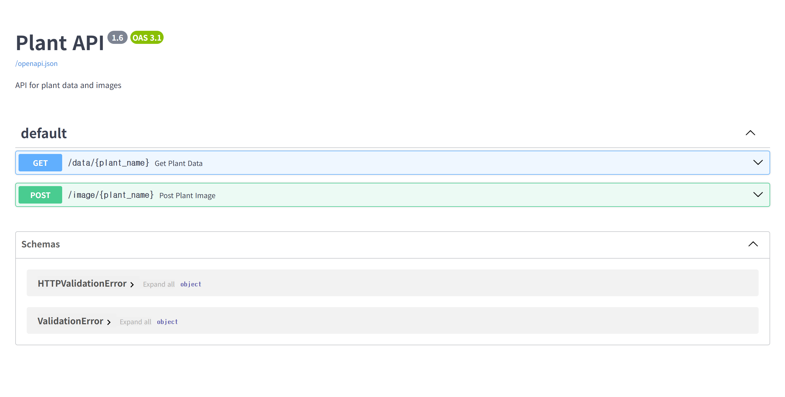
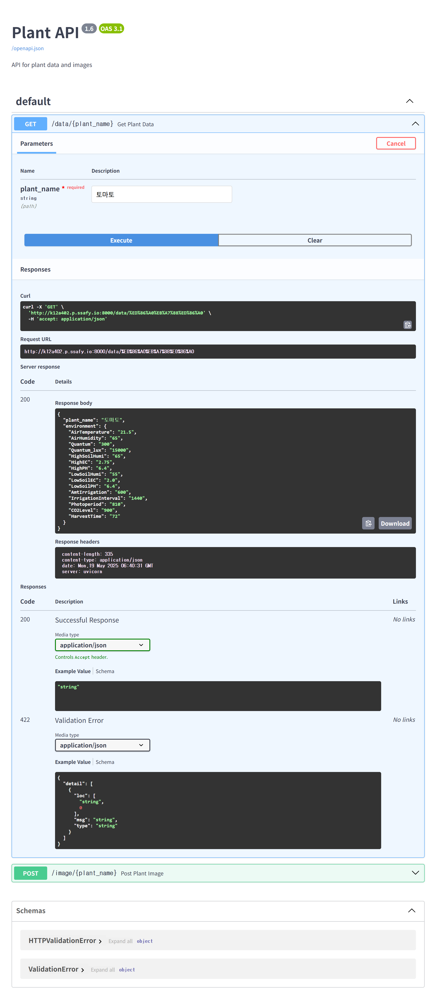
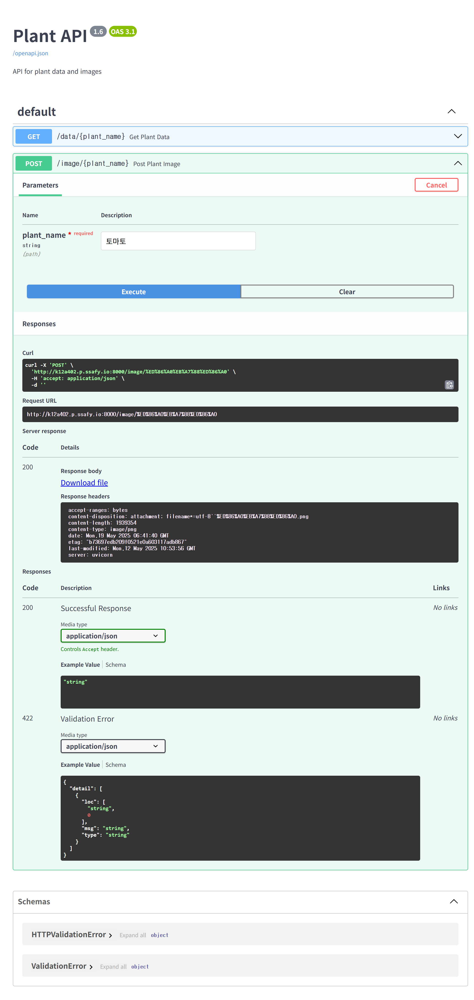

# PlantInfo API: RAG 기반 LLM 개발

<p align="center">
  
</p>

SSAFY 자율 프로젝트: 식물 이름 기반 생육 정보 및 이미지 생성 API 시스템  
개발 기간: 2025/06 ~ 2025/07

---

## 프로젝트 소개

**PlantInfo API**는 사용자가 입력한 식물 이름을 바탕으로 해당 식물의 최적 생육 환경 정보를 제공하고, 일러스트 스타일의 귀여운 이미지를 생성해주는 AI 기반 API 서비스입니다.

OpenAI의 GPT 및 DALL·E 모델을 활용하여, 텍스트 기반 데이터 분석 및 이미지 생성 기능을 통합하였습니다. 식물 이름이 포함된 요청에 대해 신뢰도 높은 생육 데이터를 반환하고, 이미지 파일을 자동 생성하여 즉시 제공합니다.

---

## API 배포 주소

API 서버 주소: `http://k12a402.p.ssafy.io:8000/docs`

- 생육 정보 조회: `GET /data/{plant_name}`
- 이미지 생성 요청: `POST /image/{plant_name}`

---

## 팀 소개

| 이름   | 역할            | GitHub 링크                                | 비고                          |
| ------ | --------------- | ------------------------------------------ | ----------------------------- |
| 김찬호 | AI/Backend 개발 | [@nonamed19](https://github.com/nonamed19) | FastAPI + LLM 파이프라인 개발 |

---

## 시작 가이드

### Requirements

```
- Python 3.10+
- FastAPI
- OpenAI
- LangChain
- Uvicorn
- Requests
- dotenv
```

### Installation

```bash
$ git clone https://github.com/nonamed19/PlantInfo-API.git
$ cd PlantInfo-API
$ pip install -r requirements.txt
$ uvicorn main:app --reload
```

---

## 기술 스택

### Backend

- **FastAPI**: 경량 API 서버 프레임워크
- **LangChain**: LLM 연동 파이프라인 구성
- **OpenAI GPT-4o**: 식물 생육 정보 추출
- **OpenAI DALL·E 3**: 식물 이미지 생성

### Data

- `datasets.json`: 사전 구축된 식물 생육 정보 DB
- `자동 업데이트`: 새로운 식물 요청 시 자동 저장

### Deployment

- `Docker Container`: API 서버 배포
- `AWS EC2`: 서버 호스팅

---

## 화면 구성

|                                 생육 정보 생성                                  |                                식물 이미지 생성                                |
| :-----------------------------------------------------------------------------: | :----------------------------------------------------------------------------: |
|  |  |

## 주요 기능

### 1. 데이터 수집 및 구축 자동화 도구

1. `drfull_crawler.py`

- 식물 정보를 `https://drfull.im/plants/` 페이지에서 BeautifulSoup을 통해 크롤링
- 각 식물의 영어 이름, 소개, 물주기/햇빛/습도/온도 정보를 수집
- JSON 형태로 저장
- 크롤링 간 0.5초 대기시간을 두어 서버 부담 완화

2. `GPT_based_bigdata.py`

- JSON 파일에 존재하는 식물명을 기반으로 GPT-4o를 호출하여 생육 환경 정보 추출
- 함수형 호출 기능을 통해 파싱된 구조로 데이터 저장

3. `Upstage_Document_Parser.py`

- Upstage Document Parser API를 활용한 제품 설명서 PDF 처리 도구
- PDF 파일을 HTML, Text, Markdown으로 변환
- OCR 및 좌표 추출 기능 포함, 결과를 JSON으로 저장

### 2. 식물 생육 정보 조회 API

- `/data/{plant_name}` (GET)
- 사전 구축된 데이터가 없을 경우 LLM을 호출해 데이터를 생성
- JSON 형식의 최적 생육 조건 반환

### 3. 식물 이미지 생성 API

- `/image/{plant_name}` (POST)
- DALL·E 3를 활용하여 식물 이미지 자동 생성
- PNG 파일 형태로 직접 다운로드 가능

---

### 전체 흐름(RAG 기반)

1. 사용자가 식물 이름 입력
2. `/data` API 호출
3. 기존 DB 탐색 → 없을 경우 GPT 호출
4. 생육 정보 파싱 및 저장
5. `/image` API 호출
6. 기존 DB 탐색 → 없을 경우 DALL·E 3 호출
7. 이미지 생성 및 저장
8. JSON 응답 반환

---

## 향후 개발 계획

- 벡터 DB + RAG 통합으로 정확도 향상
  - 식물 생육 정보 DB 구축을 임의로 수행한 이유는 식물 생육 정보 기반 벡터 DB 탐색이 비효율적이기 때문
  - 따라서, 식물 생육 정보 DB를 `web crawling`을 통해 직접 구축하여, json 형태의 DB로 저장 후 식물 이름만으로 RAG 기반 검색이 가능하도록 구현
- 이미지 생성 API에 대한 비동기 처리 구현
  - 이미지 생성 요청 시, 사용자가 대기하지 않고 다른 작업을 수행할 수 있도록 비동기 처리 구현
- 식물 분류 및 추천 기능 추가

---

## 기타 추가 사항들

- 사용 모델: OpenAI GPT-4o, DALL·E 3
- JSON 저장 구조: `datasets.json`, `drfull_dataset.json`, `plant_environment_data.json`
- 이미지 경로: `images/{plant_name}.png`

---
