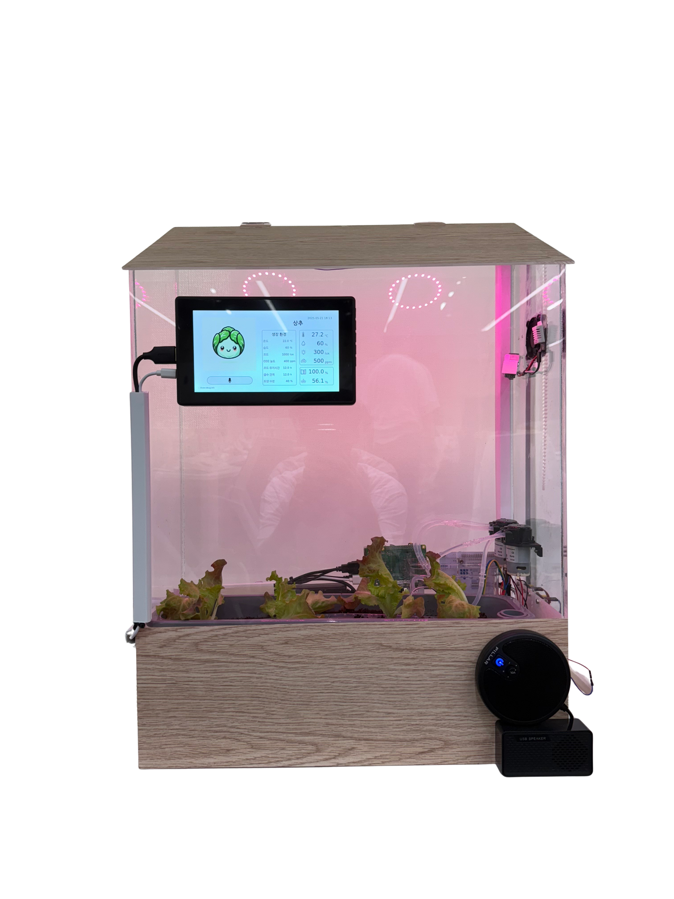
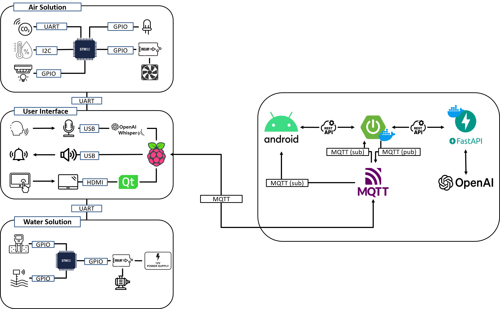

<div style="display: flex; align-items: center;">
  <div style="text-align : center">
    
  </div>
  <h1 style="margin: 0; font-size: 2em;">
    Leafree 스마트팜 프로젝트
  </h1>
</div>

<p align="center">
  
</p>

## 프로젝트 소개
Leafree는 가정용 스마트팜 키트로, 사용자가 쉽고 재미있게 식물을 관리할 수 있도록 돕는 시스템입니다. STM32 기반 센서·액추에이터 모듈과 Raspberry Pi 기반 AI·디스플레이 모듈이 유기적으로 연동되어 작동합니다.

- **통합 환경 제어**: 온습도·조도·CO₂ 농도를 자동으로 모니터링하고 조절합니다.
- **자동 급수**: 토양수분 센서를 통해 현재 습도를 측정해 필요한 만큼 물을 공급합니다.
- **음성 인식**: Whisper Tiny 모델 기반 STT 모듈을 통해 사용자의 음성 명령을 처리합니다.
- **생성형 AI 캐릭터**: LLM을 통해 작물별 캐릭터를 생성해 OLED에 디스플레이합니다.
- **디바이스·앱 양방향 UI**: STM32 디바이스에서 직접 제어하거나 Android 앱을 통해 원격 제어할 수 있습니다.

## 시스템 구성

<p align="center">
  
</p>

## 주요 하드웨어

- STM32 NUCLEO-F103RB 보드 (센싱·액추에이팅 모듈)
- 토양수분 센서
- 온습도 센서 (DHT22)
- 조도 센서 (BH1750)
- CO₂ 센서 (MH-Z19)
- 워터 펌프·서보 모터
- OLED 디스플레이
- Raspberry Pi (AI 처리 및 UI 표시)

## 소프트웨어 구조

```
Leafree/
├─ EM/                      # STM펌웨어, 라즈베리파이4 
│   ├─ Water_Solution/      # STM32F103RB, FreeRTOS
│   ├─ Air_Solution/        # STM32F103RB, FreeRTOS
│   ├─ STT/                #라즈베리파이4 (STT)
│   └─ Interface/          #라즈베리파이4 (QT)
├─ WEB/                      
│   ├─ Leafree/             # 안드로이드 앱
│   └─ backend/             # 스프링부트
├─ exec/                    # 배포 가이드
└─ docs/
```

## 설치 및 빌드

### STM32 펌웨어 (Water_Solution, Air_Solution)
1. STM32CubeMX로 프로젝트 생성  
2. 원하는 Solution 폴더 내 `Core`폴더 복사
3. ST-Link를 통해 펌웨어 업로드  

### Raspberry Pi 모듈
1. Raspberry Pi OS 설치 및 네트워크 설정  
2. Python 3.11 이상, C++17 툴체인 준비  
3. Whisper Tiny 모델 연동:
   ```bash
   pip install whisper
   ```
4. 서비스 실행(QT + STT):
   ```bash
   sudo ./EM/Interface/startup.sh
   ```

### 안드로이드 앱 APK
1. 안드로이드 폰 연결
2. APK 파일을 옮겨 앱 설치 및 실행

## 사용법

1. 전원 인가 후 STM32 모듈이 센서 데이터를 수집합니다.  
2. Raspberry Pi가 음성 명령을 대기하고, 명령에 따라 환경을 제어합니다.  
3. 마이크 버튼을 눌러 음성 입력을 통해 식물을 등록합니다.
3. OLED에 현재 상태와 AI 캐릭터가 표시됩니다.  
4. Android 앱을 통해 원격으로 수동 제어 및 상태 모니터링 가능  

## 기여 가이드

1. 이슈 등록 및 브랜치 생성: `feature/xxx` 또는 `bugfix/xxx`  
2. PR 생성 전 코드 스타일 점검 및 빌드 확인  
3. 리뷰 후 병합  

---

> **프로젝트 시작일**: 2025-04-15  
> **프로젝트 마감일**: 2025-05-22

