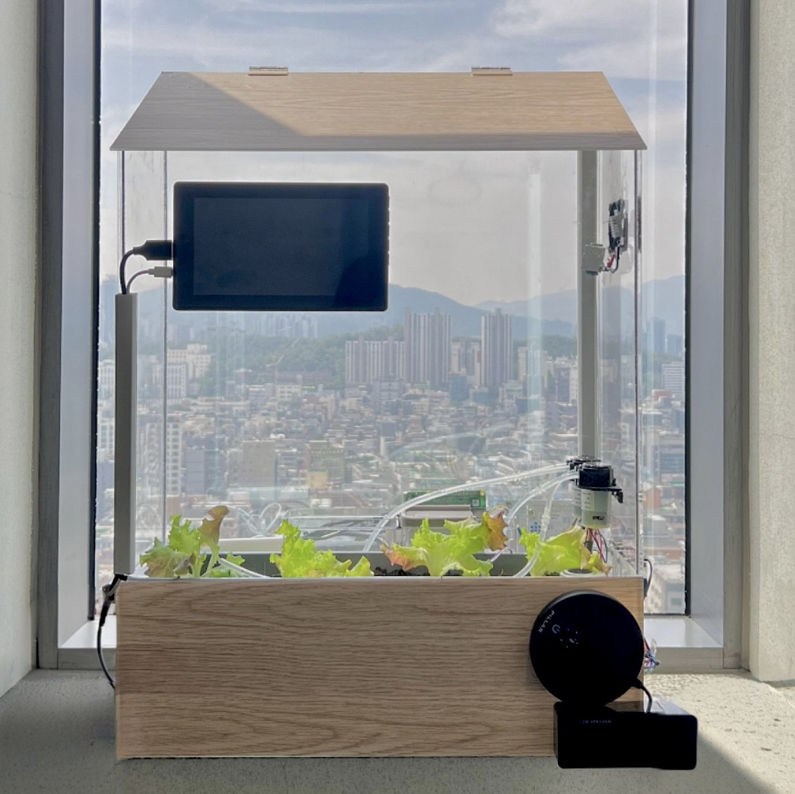
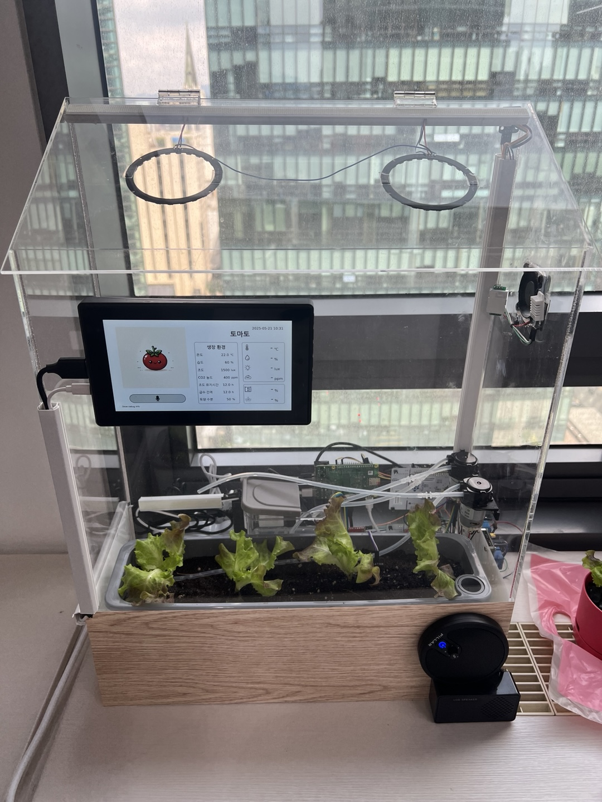
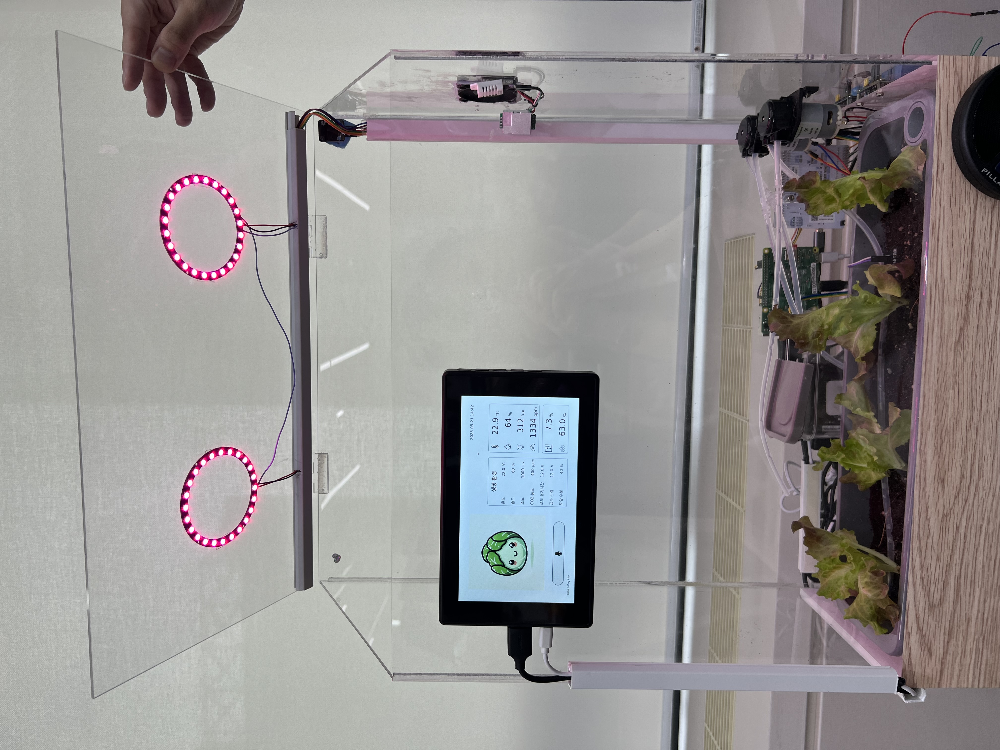
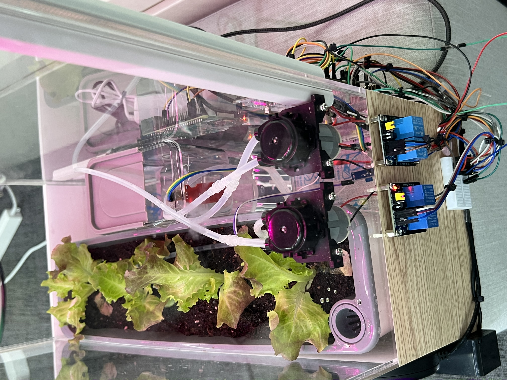
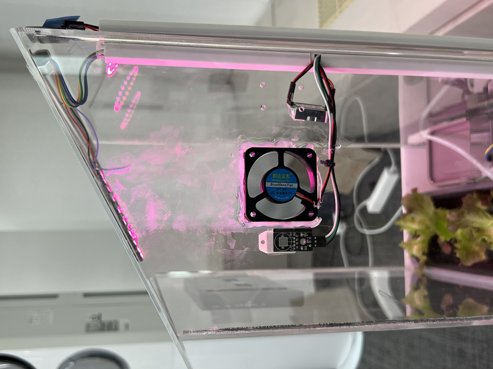
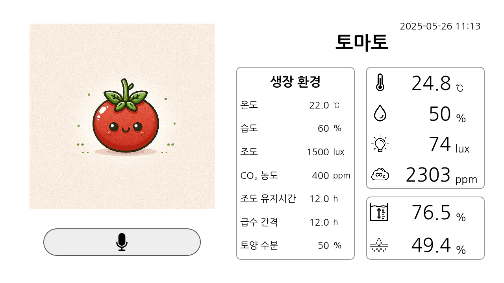
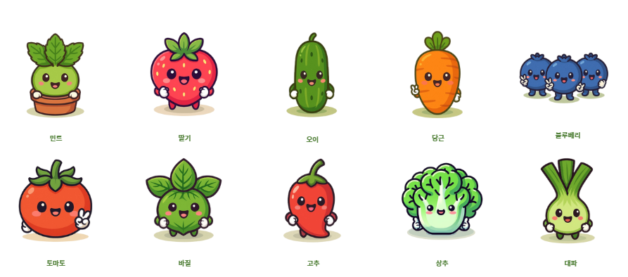
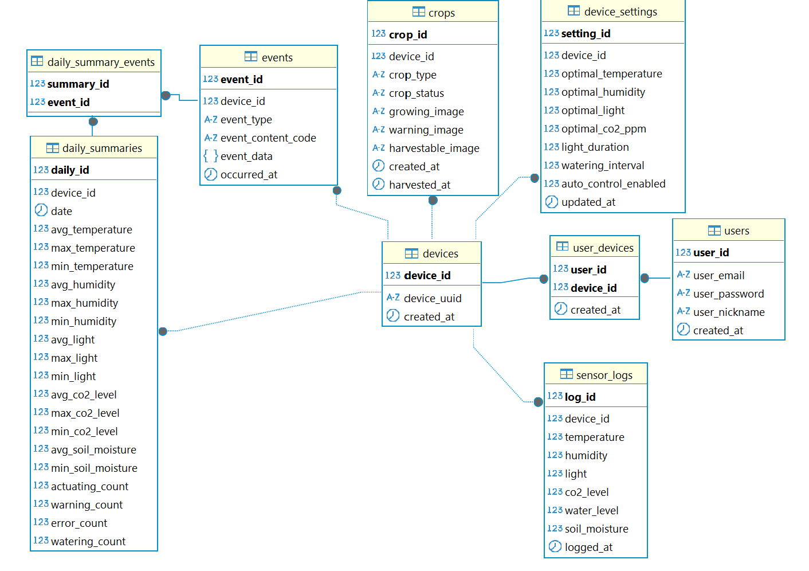
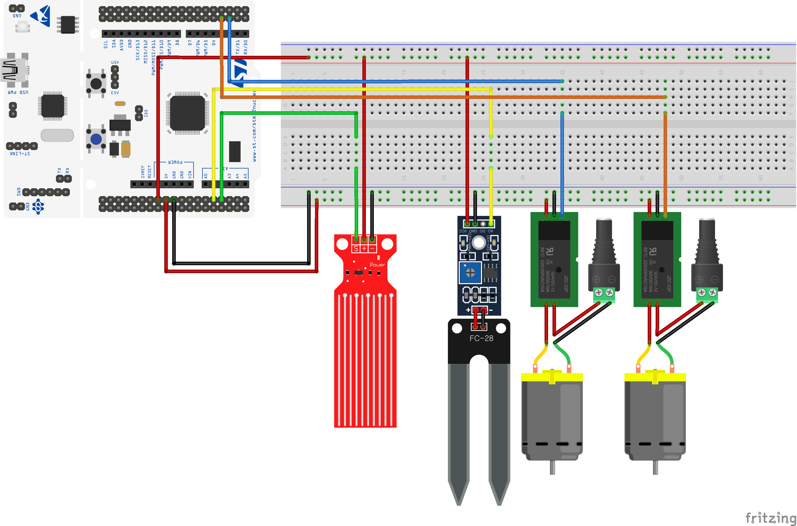

# Leafree: AI 기반 스마트팜 환경 제어 시스템

<p align="center">
  
</p>

SSAFY 자율 프로젝트 : 

Leafree(리프리)는 Leaf(잎) + Free(자유롭게)의 의미를 담아, 누구나 식물을 자유롭게, 쉽게 키울 수 있도록 돕는 가정용 스마트팜입니다.

음성/앱으로 식물을 선택하면, Leafree가 알아서 환경을 조절해주고, 귀여운 캐릭터로 식물 상태까지 보여줍니다.

개발 기간 : 2025/04/15 ~ 2025/05/22

## 프로젝트 소개

**Leafree**는 사용자로부터 음성 또는 수동 입력을 받아 식물 이름을 인식하고, 해당 작물에 최적화된 생장 환경을 AI 기반으로 생성하여 실시간으로 IoT 기기 제어에 반영하는 **스마트 가정용 재배기 시스템**입니다.

- 작물 이름만 입력하면 자동으로 최적 온도, 습도, 조도, 토양 수분 조건이 설정됩니다.
- 실시간 센서 데이터 수신 및 조건 이상 시 자동 환경 제어
- FCM 기반 푸시 알림 및 작물 일지 제공
- AI 이미지 생성 기반 감성 캐릭터 UI 구현

## 배포 주소

- **앱 다운로드 및 소개 페이지**: `https://leafree.kr`
- **Backend API**: `https://leafree.kr/api/`
- **LLM API (FastAPI)**: `https://leafree.kr/llm-api/`
- **Jenkins**: `https://jenkins.leafree.kr`

## 팀 소개

| 이름   | 역할       | GitHub | 담당 업무 |
|--------|------------|--------|-----------|
| 김찬호 | AI         | [@nonamed19](https://github.com/nonamed19) | LLM + RAG 프롬프트 엔지니어링 |
| 김채연 | EMBEDDED   |  | STM 센싱 + 에어 솔루션 |
| 김태하 | EMBEDDED   |  | CI/CD, QT 인터페이스 제작 |
| 박희준 | EMBEDDED   |  | STM 센싱 + 워터 솔루션 |
| 유하람 | BE/ANDROID |  | 안드로이드 어플리케이션 풀스택 개발 |
| 홍정주 | EMBEDDED   |  | 음성 인식 기능 개발 |

## 설치 가이드

### Requirements

```
- Java 17 + Spring Boot 3.4.5
- Python 3.10 + FastAPI
- MySQL 8.0.42
- Redis 6.0.16
- Mosquitto MQTT 2.0.11
- Docker, Jenkins, Nginx, Certbot
- Android Studio / Jetpack Compose
```

### Installation

#### Backend (Spring Boot)

```bash
$ cd backend
$ gradle build
$ cd ..
$ docker build -f backend/Dockerfile -t leafree-backend .
```

#### FastAPI (LLM)

```bash
$ cd llm_server
$ pip install -r requirements.txt
$ uvicorn app.main:app --reload
```

#### STM Firmware

```bash
1. STM32CubeMX로 프로젝트 생성  
2. 원하는 Solution 폴더 내 `Core`폴더 복사
3. ST-Link를 통해 펌웨어 업로드  
```

#### Raspberry Pi Module

```bash
1. Raspberry Pi OS 설치 및 네트워크 설정  
2. Python 3.11 이상, C++17 툴체인 준비  
3. Whisper Tiny 모델 연동:
$ pip install whisper

4. 서비스 실행(QT + STT):
$ sudo ./EM/Interface/startup.sh
```

## 기술 스택

### Android

- Jetpack Compose, Kotlin, Material3
- ViewModel + LiveData + Retrofit
- Firebase FCM 푸시 알림
- MQTT 센서 데이터 실시간 수신

### Backend

- Spring Boot, WebFlux, JPA, Redis, MySQL
- JWT 인증, Firebase Admin SDK
- WebClient 기반 FastAPI 연동
- MQTT 통신: Paho MQTT, Integration MQTT

### LLM

- LangChain + OpenAI API + RAG
- 작물명 입력 → 생장 조건 JSON + 이미지 생성
- 데이터셋 기반 보완 + fallback 생성형 AI

### Hardware

- STM32 NUCLEO-F103RB 보드 (센싱·액추에이팅 모듈)
- 토양수분 센서
- 온습도 센서 (DHT22)
- 조도 센서 (BH1750)
- CO₂ 센서 (MH-Z19)
- 워터 펌프·서보 모터
- OLED 디스플레이
- Raspberry Pi (AI 처리 및 UI 표시)

## 화면 구성

|                                  스마트팜 제품                                  |                               자동 LED 관리                               |
| :--------------------------------------------------------------------------------: | :--------------------------------------------------------------------------: |
|  |  |
|                                  워터 솔루션                                  |                               에어 솔루션                               |
|     |  |
|                                  QT 디스플레이                                  |                               생성형 AI 이미지                               |
|     |  |

## 핵심 기능

- **통합 환경 제어**: 온습도·조도·CO₂ 농도를 자동으로 모니터링하고 조절합니다.
- **자동 급수**: 토양수분 센서를 통해 현재 습도를 측정해 필요한 만큼 물을 공급합니다.
- **음성 인식**: Whisper Tiny 모델 기반 STT 모듈을 통해 사용자의 음성 명령을 처리합니다.
- **생성형 AI 캐릭터**: LLM을 통해 작물별 캐릭터를 생성해 OLED에 디스플레이합니다.
- **디바이스·앱 양방향 UI**: STM32 디바이스에서 직접 제어하거나 Android 앱을 통해 원격 제어할 수 있습니다.

## 시스템 아키텍처


## ERD



## 핀설계



## 향후 개발 방향

- 실제 농장 테스트 및 환경 고도화
- 작물 데이터셋 확장 및 사용자 추천 기능 강화
- OpenCV 기반 작물 성장 상태 시각 분석
- 음성 명령 고도화 및 다국어 대응
